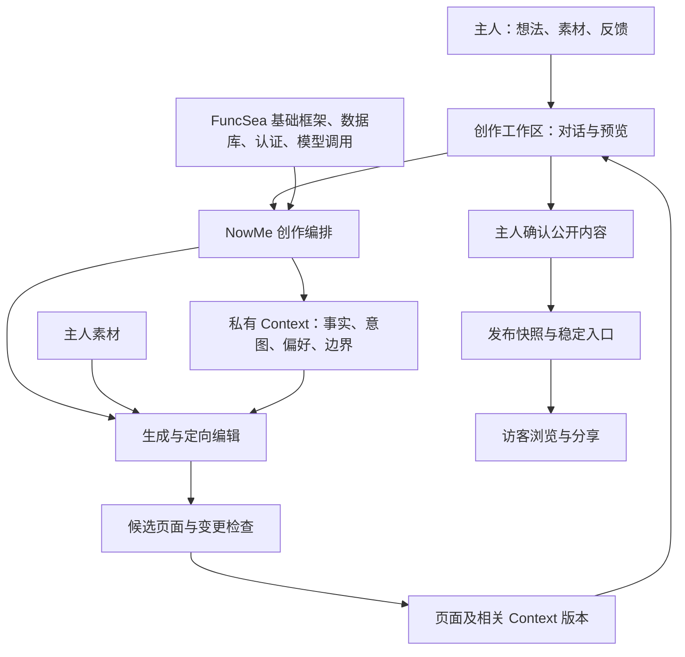

# FuncSea 改造为 NowMe 的可行性评估

> 历史复用评估。当前产品以 [接口约定](contracts.md) 和 [自带 API 方案](hosted-route.md) 为准：收费与商业额度已取消，网页创作使用用户账号中加密保存的 API Key，仍保留运行保护限制。

日期：2026-10-07。需求基线：[NowMe 产品 MVP 文档](/Users/axiom/Projects/NowMe/docs/product-mvp.md)。

**结论：可以利用 FuncSea 的基础资产建设 NowMe，建议选择性复用基础框架、数据库、认证和模型调用代码，新增 NowMe 的创作核心。当前附件不足以直接改出完整的消费者产品，也不足以评估完整 vibe coding 平台的复用成本。**

它最有帮助的地方是减少基础服务的重复开发。NowMe 的主要研发任务仍然是：获得并维护用户 context，把素材与表达意图转为可变的个人主页，准确修改，恢复版本，以及可靠发布。

本次完成源码核对与临时目录中的模块组装验证，未修改 FuncSea 源码，也未开始实现 NowMe。本文中的架构和改造顺序均为建议，没有替换现有产品需求或将待确认决策定案。

## 1. 实际拿到的资产与评估边界

| 目录 | 本次看到的内容 | 可支持的判断 |
| --- | --- | --- |
| `func-sea-templates` | FastAPI 基础后端、React/Vite 前端、11 个模块、场景配方、本地安装器、启动与 Lambda 适配代码 | 可以评估基础工程资产和模块接口 |
| `funcsea` | README、Git 元数据；README 列出三个镜像仓库入口 | 可以确认项目还包含其他仓库，无法据此评价它们的实现 |
| `reports` | 既有技术评估及验证材料 | 作为背景参考；影响本结论的关键问题重新核对和复现 |

附件中没有提供 `atoms-python` 和 `deploysvc` 的源码。AI 编程代理、项目调度、构建与修复循环、部署控制面等能力，不能仅凭镜像入口认定已可复用。[仓库入口说明](/Users/axiom/DeepWisdom/FuncSea/funcsea/README.md:1)

主要源码快照：`f035895865d61384d8d9cbd66260df7c285cf8a1`，本地 HEAD 提交日期为 2026-01-22。此日期不代表远端没有更新。

本次不下载上述镜像，不调用真实认证、存储或模型服务，不进行外部部署。附件中的快速开始、任务清单和推荐组合属于被评估的材料，未当作用户要求执行；改造方向以 NowMe 当前需求为准。

## 2. 对 NowMe 各项需求的覆盖

“有基础”表示存在可参考的实现，不表示原样可用于 NowMe 或已通过真实服务测试。

| NowMe 需求 | 当前附件覆盖 | 所需改造 |
| --- | --- | --- |
| M01 账号与创作归属 | 有 OIDC、JWT、用户表；缺少主页及素材归属模型 | 适配 NowMe 登录；建立内部用户身份、主页和素材所有权 |
| M02 低门槛创作入口 | 有 UI 组件与基础页面；未见面向主人创作的工作区 | 新建移动端友好的对话、上传、预览与目标选择流程 |
| M03 渐进式获取 context | 有模型调用；未见追问策略与理解更新机制 | 新建素材理解、必要追问、反馈提取和 context 更新流程 |
| M04 有效 context 维护 | 未见对应数据模型与服务 | 保存来源、确认状态、范围、有效性；处理冲突、纠正、删除与恢复 |
| M05 自动匹配与生成 | 有通用和电商工程模板；未见个人空间生成器 | 新建表达设计起点、自动匹配、内容组织、布局生成与结果校验 |
| M06 自然语言编辑 | 未见页面目标定位、局部变更与保真机制 | 为页面元素建立稳定标识，生成定向变更，检测无关变化 |
| M07 素材管理 | 有存储包装与图片上传模块；存在接口不一致 | 修复或重写上传流程，增加所有权、私有草稿素材和发布素材管理 |
| M08 预览与版本恢复 | 未见页面和 context 联动的版本系统 | 建立不可变版本，支持候选结果、接受、撤销与恢复 |
| M09 公开确认与发布 | 有单个应用的运行适配；未见个人主页发布模型 | 新建公开内容投影、发布快照、稳定入口和发布切换 |
| M10 分享与访客体验 | 有 Web 前端基础；未见 NowMe 微信分享链路 | 新建访客页、分享封面、二维码及微信承载验证 |
| M11 更新、撤回与删除 | 未见对应业务状态 | 新建主页生命周期与缓存、素材访问的同步处理 |
| M12 能力范围与失败处理 | 有部分 API 错误处理；未见创作任务状态与恢复 | 新建任务记录、额度、失败保留、重试与用户可理解的反馈 |

**不能把 `aihub` 的聊天调用等同于“模型已经了解用户”，也不能把工程模板等同于可自由修改的个人空间。** AI Hub 当前主要包装文本、图像与流式模型接口；如何选取 context、如何维护理解、如何生成和修改页面，需要上层业务实现。[AI Hub 服务](/Users/axiom/DeepWisdom/FuncSea/func-sea-templates/modules/aihub/backend/services/aihub.py:22)

## 3. 具体保留、改造与暂缓的部分

| 资产 | 建议处理 | 理由及边界 |
| --- | --- | --- |
| FastAPI 基础后端 | 选取并整理 | 可沿用服务组织、配置和日志基础；核心路由宜显式注册并在启动时核验，避免导入失败后静默缺失 |
| React/Vite、通用 UI 组件 | 选取复用 | 适合建设 Web 创作工作区；需重新设计 NowMe 的流程、手机操作和访客表现 |
| `database` | 复用基础连接与会话代码 | 新增 NowMe 数据表及正式迁移；当前 `create_all` 和已注释的字段修复不是业务版本迁移方案 |
| `auth` | 保留会话思路，改造身份适配 | 可以配置独立 OIDC 服务；微信身份需要额外接入。当前使用外部 `sub` 作为用户主键，邮箱必填，不适合未经调整就作为多入口统一账号模型 |
| `storage` | 保留业务接口思路，替换或接入实际存储服务 | 当前调用外部 OSS 服务，并非仅填 R2 凭证就能独立运行的直接存储客户端 |
| `image_upload` | 优先修复或重写为 NowMe 素材服务 | 存储契约已不一致，也缺少用户所有权字段；此模块不能按名称判断为现成上传能力 |
| `aihub` | 抽成模型适配层 | 可以减少接入包装工作；模型、参数和接口兼容性需要实际验证，创作编排不放在通用透传接口里 |
| Manifest、场景配方 | 参考组织方法 | 可用于整理工程能力；MVP 不必先建设完整的通用模块安装与升级平台 |
| Lambda、长启动脚本 | 按选定部署方式取用 | 有环境适配经验；与原平台的域名、变量替换和生命周期耦合，需要拆解 |
| 商品、购物车、订单、支付、商品推荐 | 首期不引入 | NowMe 当前聚焦个人主页创作与展示，这些业务模块没有直接覆盖 P0 需求 |
| 多套电商主题 | 作为局部视觉素材参考 | 不适合作为 NowMe 的个性表达分类；主页的组织与风格应由用户素材和反馈决定 |

前端模板还包含 `@metagptx/web-sdk` 和来源定位插件，部分依赖使用 `latest`。应核对实际用途，替换需要独立实现的调用、移除无需保留的集成，并锁定验证过的版本。[前端 API 客户端](/Users/axiom/DeepWisdom/FuncSea/func-sea-templates/templates/base/frontend/default/src/lib/api.ts:1)、[Vite 集成](/Users/axiom/DeepWisdom/FuncSea/func-sea-templates/templates/base/frontend/default/vite.config.ts:4)

认证可以适配其他身份提供者，模型服务也可以配置其他兼容端点；现有代码并不意味着永远绑定原平台。真正要确认的是具体接口、身份规则和运行配置。[认证用户映射](/Users/axiom/DeepWisdom/FuncSea/func-sea-templates/modules/auth/backend/services/auth.py:20)、[存储服务初始化](/Users/axiom/DeepWisdom/FuncSea/func-sea-templates/modules/storage/backend/services/storage.py:27)

## 4. 本次重新验证的接入问题

在临时目录安装 `database + auth + storage + aihub + image_upload`，没有安装依赖或启动真实应用。结构化结果保存在[本次验证证据](/Users/axiom/Projects/NowMe/docs/funcsea-adaptation-evidence-2026-10-07.json)。

| 观察 | 本次结果 | 对改造的影响 |
| --- | --- | --- |
| 五模块后端组装 | 安装器返回成功，44 个后端 Python 文件语法检查无错误 | 可作为工程取材起点；不证明导入、接口或业务运行正确 |
| 前端集成 | 没有安装认证 Context，也没有注入认证 Provider | 当前安装器没有完成前后端一体化集成 |
| Lambda 初始化 | 后端主入口有数据库启动动作，Lambda 文件与基础模板完全一致，没有对应注入 | 不能据本地组装成功推断 Lambda 运行路径已可用 |
| 配置变量 | 组装后的配置中仍有 16 处占位符 | 原平台的变量注入需要独立实现或明确配置，不是可运行的最终配置 |
| 依赖模块 | 单独安装认证不补数据库，单独安装图片上传不补存储及数据库 | 不宜依赖安装器自动保证组合完整 |
| 重复安装 | 认证配置声明和环境变量均出现两次 | 原样重复运行会造成配置累积 |
| 未知模块 | 安装器跳过后仍返回成功 | NowMe 的基础检查需要明确失败，不能仅看安装器退出状态 |
| 上传接口契约 | 图片服务传入 `filename`；存储请求要求 `bucket_name` 与 `object_key`。图片服务还读取存储响应未声明的 `file_key` 与 `access_url` | 即使所有模块复制成功，上传代码仍存在明确的源码契约不一致 |
| 素材归属 | 本地图片表没有主人字段，图片路由只依赖数据库连接 | 独立作为多用户产品时需要明确鉴权与资源归属；附件外网关是否补充保护未知 |

这些结果反映当前附件的集成缺口，不等于完整平台没有解决相关问题。上传契约与归属项来自源码核对，未发送真实 HTTP 请求。[图片上传调用](/Users/axiom/DeepWisdom/FuncSea/func-sea-templates/modules/image_upload/backend/services/image_upload.py:47)、[存储请求模型](/Users/axiom/DeepWisdom/FuncSea/func-sea-templates/modules/storage/backend/schemas/storage.py:57)、[图片路由](/Users/axiom/DeepWisdom/FuncSea/func-sea-templates/modules/image_upload/backend/routers/image_upload.py:24)

不建议为了 NowMe 先修复全部电商和支付业务。应先整理实际选用的基础模块，并使 NowMe 的启动和核心接口检查能够发现失败。[本地安装器](/Users/axiom/DeepWisdom/FuncSea/func-sea-templates/manager.py:183)

## 5. 建议的产品架构

**先建设一个统一的 NowMe 创作服务。每个个人主页作为独立作品保存、渲染和发布。** 对首期建议的文字、图片、链接及少量交互，这比为每个人创建一套数据库、后端和部署环境更容易控制版本、公开范围和成本。

这是针对 NowMe 首期范围的工程建议；如果后续确实要支持用户自定义业务后端，应重新评估项目级生成与部署能力。

新增能力可以按五个职责组织，不要求一开始拆成五个独立服务：

1. **创作理解：**提取素材事实、展示意图、具体偏好和边界；只追问会明显影响结果的未知信息。
2. **素材与主页：**保存主人归属、素材引用、页面结构、设计表现和已支持的交互。
3. **生成与编辑：**自动选择设计起点，生成候选结果，处理局部修改与整体改版。
4. **版本与任务：**记录候选结果、接受、撤销、恢复、失败和费用；保持页面与当前创作理解一致。
5. **发布与分享：**只对外提供主人确认的作品，管理稳定地址、更新、撤回和访客访问。

### 5.1 首期应验证的生成机制

| 路线 | 对 NowMe 的优点 | 需要解决的问题 | 本次建议 |
| --- | --- | --- | --- |
| 固定模板填字段 | 起步快，呈现稳定 | 难以满足改变内容组织、布局和交互的要求 | 只作为基准对照，不作为产品最终能力 |
| 自由结构化页面描述与渲染器 | 页面节点有稳定标识，便于局部修改、检查与恢复；能统一手机表现 | 需要验证布局、样式和组件表达是否足够丰富 | 优先做技术实验 |
| 模型直接生成页面代码 | 可探索更丰富的视觉与结构 | 构建、依赖、局部编辑漂移、隔离与运行验证成本更高；附件缺少完整代理和部署实现 | 用相同素材做对照实验，再决定是否进入首期 |
| 结构化内容与可验证表现扩展相结合 | 可以保留素材、归属与版本，同时扩大设计表达 | 数据与生成表现之间需要一致的标识和修改协议 | 根据实验决定是否采用 |

“结构化”应指自由组合的页面树与可变布局，不是固定的姓名、学校、履历等字段。文字、图片和链接可以增删、分组、重排；布局可以从流式、网格变为错落拼贴；配色、字体、间距和已支持的交互也可以变化。初始设计只是系统内部起点。

这条路线是否够用，必须用“相同素材做卧室墙面和安静记录本，再只改两张照片”的实验检验。如果只能换颜色或填预设位置，就不满足当前需求，应扩展表现能力或选择混合/代码生成路线，不能为迁就底座缩窄产品。

如果实验采用生成代码，应在隔离环境构建和预览，通过素材引用、手机呈现、链接与交互检查后形成候选版本；生成结果不接触主人的会话凭证和私有服务密钥。这直接服务于当前需求中的运行隔离与失败恢复。

### 5.2 理解、编辑和版本必须联动

建议的核心记录包含：`User`、`Identity`、`Space`、`Asset`、`Conversation`、`ContextEntry`、`CreationTask`、`Revision`、`Publication`。这是职责示意，不是已经定案的数据库设计。

- Context 保存事实、意图、偏好与边界，并保留来源、确认状态、适用范围和有效性。不能只保存聊天记录，依靠下次模型重新猜测。
- 页面元素使用稳定标识。用户点中照片或区域后说“只错开这两张”，编辑任务可明确目标和允许变更范围。
- 一次局部编辑根据指定基础版本生成候选变更，先校验再展示。主人的文字编辑与 AI 修改同时发生时，检查版本冲突，不覆盖较新结果。
- 一次接受应同时关联页面、素材引用与相关创作状态。撤销或恢复时同步这些状态，失败任务不覆盖已接受版本。
- “从本次页面移除学校”和“删除保存的学校信息”是不同操作。公开边界、撤回信息、彻底删除信息的约束不能因恢复旧版本而失效；历史版本和日志也应按删除范围处理。
- 发布引用明确的不可变作品快照。公开入口只读发布版本，不读聊天、完整 context 或正在修改的草稿；新发布成功后再切换入口。
- 撤回时除了页面入口，还要处理公开素材与缓存。若删除素材会影响可恢复的旧版本，应向主人说明影响并按其选择执行。

## 6. 微信与主页承载：保留选型空间

现有资产偏 Web。建议先做移动端 Web 创作与公开页实验，同时尽早验证微信里真实打开、输入、定位修改和分享的流程。此建议没有取消“小程序优先探索”的产品方向。

| 承载方案 | 与现有资产的关系 | 必须验证的事项 |
| --- | --- | --- |
| Web 创作与公开页，微信作为访问和分享场景 | React/Web 资产复用较直接 | 微信内浏览器、素材上传、登录恢复、分享呈现和访客访问 |
| 小程序入口与管理，Web 承载自由主页 | 有机会同时满足入口和 Web 表达需求 | 账号主体与域名配置、WebView 实际能力、身份衔接、返回与分享行为 |
| 原生小程序创作和渲染 | 后端可取用，前端需新增实现或适配 | 布局表达、支持的交互、包体与性能、实际分享链路 |

微信团队的 kbone 文档说明，小程序与 Web 的底层模型不同，Web 代码需要适配才能在小程序环境运行。因此当前 React/Vite 模板不能直接视为已可用的小程序前端；本评估也没有选定 kbone 作为技术方案。[微信团队 kbone 说明](https://wechat-miniprogram.github.io/kbone/docs/)

腾讯 CloudBase 的官方示例提供小程序页面分享路径、参数和小程序码的实现参考，同时明确其示例不适用于 H5 分享。不能将这一能力外推为任意公开 Web 主页已经具有相同分享方式。[CloudBase 小程序分享示例](https://docs.cloudbase.net/en/recipes/add-share-with-params-miniprogram)

本轮无法读取微信 `web-view` 与公众号 JS-SDK 官方页面，未据旧经验承诺具体主体资格、域名限制或所有分享接口可用。最终承载方式应以计划使用的账号、域名和真机链路验证后决定。

## 7. 建议改造顺序与决策门槛

| 阶段 | 交付 | 通过后才能得出的结论 |
| --- | --- | --- |
| A：整理基础接入 | 选取基础代码；处理认证、存储、前端平台依赖与配置；建立明确的启动检查 | NowMe 可以独立登录、上传和调用模型，基础模块确实可复用 |
| B：验证自由生成和修改 | 最小创作工作区、有效 context、两种明显不同的表达、局部编辑及撤销；与直接生成代码对照 | 所选生成机制能覆盖自由表达，而不是只改模板字段 |
| C：完成发布闭环 | 草稿与公开分离、稳定入口、发布更新、撤回；微信实际打开与分享验证 | 原型具备可供真实用户使用的完整闭环 |
| D：小规模用户验证 | 少量目标用户带真实素材创作；记录认同、修改、分享、失败和成本 | 判断产品价值及后续投入顺序，不只判断页面能否生成 |

这不是工期承诺。当前没有团队投入、模型选择、云资源、微信主体或完整代理实现的信息，无法可靠给出“复用百分比”“改几天就能上线”或成本金额。

阶段 B 是最值得尽早做的技术实验。验收任务建议沿用当前需求，全部使用虚构人物和研究素材：

| 实验任务 | 验收重点 |
| --- | --- |
| 仅给三张街景照片和一句“想放自己喜欢的东西” | 能启动创作；不强制填履历或选模板；不编造事实 |
| 同素材做“卧室随手贴的墙”与“安静记录本” | 内容组织和表现确实不同，不只换配色 |
| “只把中间两张照片错开，其他不动” | 目标正确；未涉及的节点、内容和表现保持稳定 |
| “这页不要学校信息”，随后继续生成 | 当前公开边界生效，学校信息不重新出现 |
| 撤销、换会话、继续编辑 | 页面及相关创作状态一致；无需从头介绍 |
| 发布后修改草稿，模拟生成与发布失败 | 访客仍看到原发布版本，输入与可用草稿保留 |
| 更新发布、撤回，通过原入口再次打开 | 地址稳定；显示正确发布状态；撤回的页面及素材访问符合预期 |
| 微信真实输入、预览、修改、分享和打开 | 完整链路可用，不仅是桌面浏览器演示成功 |

在相同任务和验收条件下记录耗时、模型调用、费用、失败、重试及人工修复。将 FuncSea 取材方案与干净的同类基础框架比较，才能确认实际节省多少工作。

## 8. 何时值得继续取得完整平台源码

如果决定让每个主页拥有生成代码、独立构建环境，或利用已有 AI 编程代理做长期代码修改，`atoms-python` 和 `deploysvc` 就成为关键评估对象。应核对它们是否已提供：

- 对话与任务的持续状态、目标文件或页面元素定位、变更协议。
- 构建及运行检查、错误修复与有边界的重试。
- 预览隔离、凭证隔离、资源限制和产物管理。
- 发布版本、原子切换、撤回、回滚与域名入口。
- 多用户归属、计量、额度和失败恢复。

这些仓库可能显著改变复用判断，但当前没有证据可估算其可用程度。仅为了验证 NowMe 的素材、理解、自由表达和分享闭环，不必等待完整通用平台到齐。

## 9. 当前可以做出的决定

**建议继续推进“选取 FuncSea 基础资产 + 新建 NowMe 创作核心”的验证原型。** 优先验证相同素材的不同表达、局部编辑稳定性、context 与版本恢复，以及微信访问分享。生成机制和最终承载方案保留为实验后的决策。

当前可以确认附件提供了可取用的工程基础，也存在明确的接入缺口；尚不能确认完整应用已可运行、AI 生成质量已满足要求、微信分享已贯通或生产部署可靠。

本次新增的是本评估与验证证据，FuncSea Git 工作区在验证前后均无变更。

补充（2026-10-07）：后续扩大到整个 DeepWisdom 目录后，在 MGX 和 MetaGPT 下找到部署、代理和工具的相关源码候选，Atoms 还提供局部编辑资产。此前“附件中未提供”的判断仅针对 FuncSea 文件夹。完整的复用优先级、依赖版本核对与仍然缺失的外部服务见[其他项目复用评估](/Users/axiom/Projects/NowMe/docs/deepwisdom-reuse-assessment-2026-10-07.md)。
